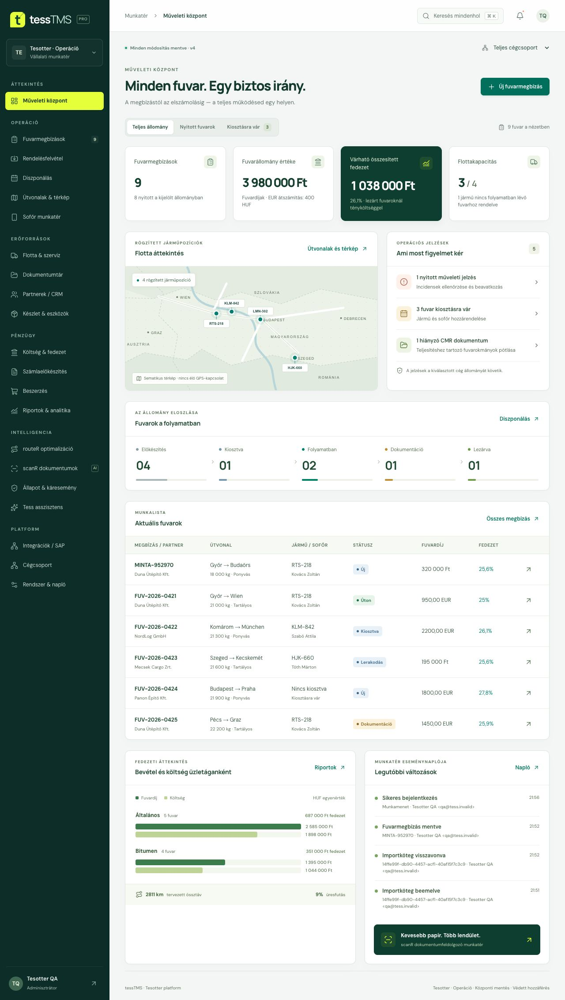

# tessTMS

A TESOTTER magyar nyelvű fuvarszervezési és vállalati műveleti munkatere. Next.js / React / TypeScript felület, szerveroldali hitelesítés, tartós SQLite-adattár és 19, egymáshoz kapcsolódó szakmai modul a repó két PDF-je alapján.

A rendszer működő fejlesztési alap és bemutatható termékverzió. A teljes tenderlefedettség, a szabályozott fuvarozási megfelelőség és valamennyi külső rendszer éles integrációja külön elfogadási feltételekhez kötött. A pontos állapot a [követelménymátrixban](docs/requirements-coverage.md) látható.



## Gyors indítás

Node.js **22.13 vagy újabb**, npm és írható helyi lemez szükséges. A támogatott alap a Node 22; az alkalmazás a beépített `node:sqlite` modult használja.

```sh
npm ci
npm run dev
```

Nyisd meg a [helyi alkalmazást](http://localhost:3000). Az első indításkor a felületen hozd létre a munkateret és az első adminisztrátort saját, legalább 12 karakteres jelszóval. Nincs beépített felhasználó vagy alapértelmezett jelszó. A bemutató mintaadatok külön választhatók; nélkülük üres munkatér indul.

Az adatok és a csatolt fájlok alapértelmezett helye `data/tess-tms.sqlite`. A böngészőadatok törlése nem törli a központi adatokat. A munkatér felhasználói ugyanazokat az adatokat látják a jogosultságaik szerint.

## Működő folyamatok

- Nyolclépéses fuvarrögzítés: partner, hitelkeret, több megálló, árumennyiségek, díj, költség, erőforrás, dokumentum és nyomtatható visszaigazolás.
- Tételszintű fel- és lerakás, méretek, plomba, hőmérséklet és ADR-adatmezők; rakodási sorrend és mennyiségi egyenleg ellenőrzése.
- Diszponálás, státuszfolyamat, időbeli jármű-/sofőr-/pótkocsiütközés és szervizellenőrzés; tárolt útvonalak.
- Ellenőrzött, kötegelt CSV- és Excel (.xlsx) import, legfeljebb 5 MB / 1000 adatsor, és a még feldolgozatlan köteg visszavonása.
- Terv/tény költség, fedezet, gyűjtött számlaelőkészítés, beszerzési jóváhagyás, flotta, partnerek, készletmozgások és riportexport.
- Központi fájltár, dokumentumverziók, hiányjelzések és szerveroldali eseménynapló.
- Elkülönített ügyfélmunkaterek, szerkeszthető cégtörzs, adminisztrátor / fuvarszervező / pénzügy / megtekintő szerepkörök; felhasználó letiltása, szerepkörváltás, saját jelszócsere és verzióütközés esetén védett mentés.
- Beállítható HERE és Google útvonalszámítás, SAP Service Layer kapcsolatteszt, HTTPS webhook elérhetőségi teszt.

## Integrációk és termékhatárok

Az integrációk külön szerveroldali környezeti változóval, egy pontosan megjelölt munkatérhez kapcsolhatók. A kulcsok nem kerülnek a böngészőbe. Beállítás nélkül nincs külső szolgáltatói adatforgalom.

| Terület                       | Jelenlegi állapot                                                                                                  |
| ----------------------------- | ------------------------------------------------------------------------------------------------------------------ |
| HERE Routing v8               | Valódi útvonal- és menetidőkérés megfelelő kulccsal; teherautó-paraméterek megadhatók.                             |
| Google Routes                 | Valódi `DRIVE` útvonalszámítás; teherautó- és ADR-korlátozásokat nem ellenőriz.                                    |
| SAP Business One              | Belépés, metaadatolvasás, kijelentkezés tesztelhető. Az outbox pénzügyi feladást még nem végez.                    |
| scanR / docR                  | Ellenőrizhető mintakivonat és dokumentumfolyamat; az automatikus OCR-hez a saját szolgáltatás API-szerződése kell. |
| GPS / project44 / Transporeon | Élő adatkapcsolat nincs aktiválva; szolgáltatói hozzáférés és adatmapping szükséges.                               |
| Sofőr munkatér                | Reszponzív belső felület; külön sofőrazonosítás és offline mobilalkalmazás még nincs.                              |
| routeR / Tess / kárfelismerés | Szabályalapú kiosztási javaslat és válaszok, kézi incidensrögzítés; AI-motor nincs csatlakoztatva.                 |
| AETR / tachográf              | Kézi vezetésiidő-tartalék és egyszerű küszöb; jogszabályi megfelelőségi motor nincs.                               |

A HUF/EUR átszámítás tervezési árfolyama jelenleg rögzített **400 HUF/EUR**. A cégválasztó a munkatéren belüli megjelenítési szűrő; a hozzáférési határ az önálló ügyfélmunkatér. A munkatér adminisztrátora saját cégeket rögzíthet és átnevezhet; új, mintaadat nélküli munkatér a saját nevével létrehozott céggel indul.

## Ellenőrzés

```sh
npm test
npx tsc --noEmit
npm run lint
npm run build
npm start
```

A tesztek üzleti szabályokat, API-hitelesítést, jogosultságot, munkatér- és fájlelkülönítést, párhuzamos módosítást és integrációs szerződéseket vizsgálnak. A GitHub Actions a telepítést, a teszteket, a típusellenőrzést és a production buildet futtatja. A böngészős vizuális és végponttól végpontig tartó ellenőrzés külön kiadási lépés; a CI nem állítja, hogy ez megtörtént.

A fejlesztői kimenet `.next-dev`, a production kimenet `.next`; a két szerver kimenete elkülönül.

## Üzemeltetés és további dokumentáció

- [Telepítés, környezeti változók, mentés és visszaállítás](docs/deployment.md)
- [Integrációs beállítások és API-határok](docs/integrations.md)
- [A két PDF egyesített követelménymátrixa](docs/requirements-coverage.md)
- [Megvalósított architektúra és következő kiadási kapuk](docs/tms-foundation.md)

Új ügyfélmunkatér a `npm run workspace:create` paranccsal, adatbázismentés a `npm run backup -- /biztonsagos/hely/mentes.sqlite` paranccsal készíthető. A pontos, titkokat védő használatot az üzemeltetési leírás tartalmazza.

## Kódszerkezet

| Hely                           | Feladat                                                                          |
| ------------------------------ | -------------------------------------------------------------------------------- |
| `app/`, `components/platform/` | Oldalak, navigáció, modulok, hitelesített kliensállapot.                         |
| `lib/tms/`                     | Tartományi modell, üzleti szabályok, import/export és fájlkezelő kliens.         |
| `lib/server/`                  | SQLite repository, hitelesítés, jogosultság, validálás és integrációs adapterek. |
| `app/api/`                     | Munkamenet, munkatér, fájlok, felhasználók, audit és integrációk végpontjai.     |
| `scripts/`                     | Munkatér-provisionálás és konzisztens mentés.                                    |
| `tests/`                       | Tartományi, biztonsági, API- és integrációs tesztek.                             |

A forrás saját fejlesztésű, nem nyilvános felhasználási licencű termék (`UNLICENSED`).

Az aktuális helyi ellenőrzések eredménye és a böngészős próbák az [ellenőrzési jegyzőkönyvben](docs/verification.md) találhatók.
