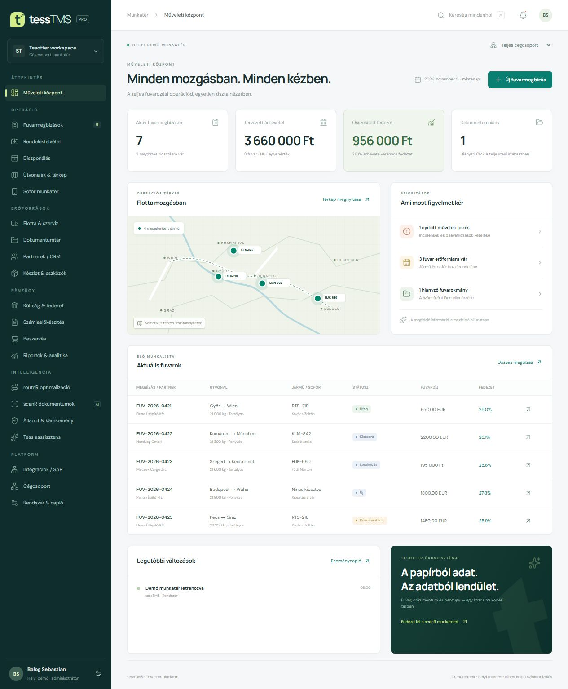

# tessTMS

Komponensekre bontott Next.js / React / TypeScript TMS munkatér, a két mellékelt PDF 19 követelménycsoportjának helyi demonstrációjával.



## Indítás

```sh
npm install
npm run dev
```

Production ellenőrzés:

```sh
npm test
npm run lint
npm run build
npm start
```

A fejlesztői kimenet `.next-dev`, a production kimenet `.next`. Ez megakadályozza, hogy a build a futó dev szerver kliensoldali csomagjait felülírja.

## Felépítés

- `app/[module]/page.tsx`: külön URL minden modulhoz, statikusan előállított oldalak.
- `components/platform/modules`: külön komponens mind a 19 követelménycsoporthoz, plusz dashboard, fuvarrögzítő és beállítások.
- `components/platform/ui`: közös panelek, táblázatok, dialógusok, mezők, állapotjelzők és térkép.
- `components/platform/store.tsx`: közös helyi adattár, mentés és eseménynapló.
- `lib/tms`: típusok, mintaadatok, validációk, CSV-kezelés, fájltár és modulkatalógus.
- `tests/domain.test.ts`: hitelkeret, foglaltság, ADR, workflow, számlázási feltételek és import tesztjei.

## Mi működik helyben?

Fuvarrögzítés nyolc lépésben, partner- és hitelkeret-ellenőrzés, több megálló, jármű- és sofőrkiosztás, drag-and-drop diszponálás, státuszváltás, fájlfeltöltés és letöltés, kötegelt CSV-import visszavonással, terv/tény költségek, számlaelőkészítés, beszerzési workflow, flotta és szerviz, CRM, készletmozgások, konszolidált riportok és CSV-export.

Az adatok a böngésző localStorage tárában, a fájlok IndexedDB-ben maradnak. A helyi eseménynapló nem megváltoztathatatlan biztonsági audit. A cégszűrő megjelenítési funkció, nem hozzáférés-védelem. A JSON adatmentés tartalmazza a rekordokat, de a bináris fájlokat külön kell letölteni.

## Külső szolgáltatást igénylő részek

- GPS / útvonal / AETR: sematikus térkép, demó vezetési tartalék és napi foglaltság; nincs jogszabályi megfelelőséget tanúsító tachográf motor.
- SAP B1: helyi outbox és sémaellenőrzés; nincs valódi feladás.
- scanR: kézzel ellenőrizhető mintakivonat beemelése; nincs automatikus OCR.
- Kárkezelés: incidens és fotódokumentáció; nincs AI sérülésfelismerés.
- Tess asszisztens: helyi adatokra épülő szabályalapú válaszok; nincs nyelvi modell csatlakoztatva.
- routeR: helyi megfelelőségi és kapacitásrangsor; nincs globális útvonal-optimalizáló motor.

Vállalati használathoz központi adatbázis, szerveroldali hitelesítés és jogosultság, tranzakciós hitelkeret-foglalás, privát fájltár, biztonsági ellenőrzések és integrációs szerződések szükségesek. Ezek státusza a Rendszer és napló modulban is látszik.

## Forráslefedettség

A modulkatalógus minden bejegyzése tartalmazza a követelménytábla fejezetazonosítóját. A helyi demó nem jelenti a táblázat minden alpontjának vállalati szintű teljesítését. Az alaparchitektúra és a következő kiadási kapuk a `docs/tms-foundation.md` dokumentumban találhatók.
